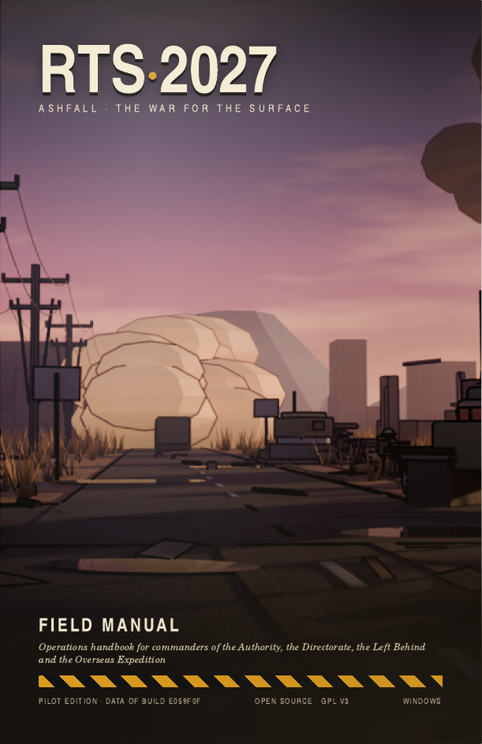
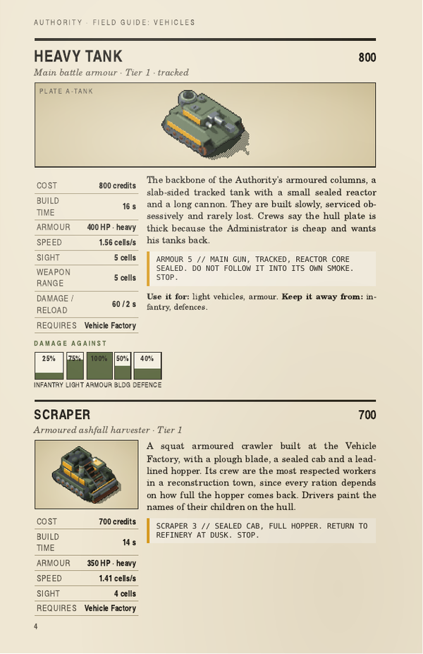

# RTS_2027

A 2D real-time strategy game in the classic Command & Conquer style, set in an atompunk world that never got past 1962.
Build a base, gather ashfall, raise an army and break the other side's. Four factions, a full campaign for each, and
skirmish against AI. Windows only; free software (GPL v3).

RTS_2027 is not affiliated with or endorsed by Electronic Arts; no EA code, art or audio is included.

> **Spoiler-free.** This file describes the setup, the factions, the systems and the content. It deliberately leaves out
> the campaign plot, the endings, the secrets and the leaders' private files. Those live in `docs/lore/`, the campaign
> scripts in `docs/missions/` and the campaign design docs in `docs/design/` (for example
> `docs/design/12_m8_plan.md`). Do not read those if you are going to play the campaigns. The in-game Archive unlocks its
> own entries as you play.

> **New session? Start with [`docs/00_START_HERE.md`](docs/00_START_HERE.md).**
> **Setup and run: see [Run it](#run-it) below.**
> **The game booklet: [`docs/field_manual/RTS_2027_Field_Manual_pilot.pdf`](docs/field_manual/RTS_2027_Field_Manual_pilot.pdf)**
> (the pilot pages of the 1990s-style game booklet; the full manual comes with M14). It names the Authority campaign
> missions with a one-line premise each, but no plot.

---

## Where it stands

*Updated 2026-11-11 (session 19).*

**Everything on the plan except LAN play is built and playable**: the simulation, skirmish with all four factions, a
tutorial and sixteen campaign missions, the Archive, the map editor, replays and the optional LLM commander. The current
work is a fix pass from the session 18 audit (M13) and the printed Field Manual (M14).

| Milestone | Status |
|---|---|
| M1 / M1.5 Deterministic simulation core (20 Hz, integer maths, seeded RNG, replays) | Done |
| M2 / M3 Playable skirmish: Authority and Directorate, full tech trees, tunnels and burrowing, superweapon, audio, main menu, Archive | Done |
| M4 Skirmish depth: procedural maps (4 biomes, 3 sizes, 2 to 4 players), garrisons, three-tier tech, upgrades, spectator mode, map editor | Done except the AI difficulty ladder balance |
| M5 LLM commander: an optional language model sets strategy and talks in character (your own API key) | Done; owner play-test with a real key pending |
| M6 The Left Behind: mobile rig bases, wrecks and salvage, raids, the Second Drift, AI, art | Done |
| M7 The Overseas Expedition: ships, submarines, landings, carriers, home shipments, beachheads, floating docks, AI, art | Playable in skirmish; final acceptance and owner play-test open |
| M8 Campaign for all four factions | Done: tutorial and 16 missions with endings; owner review of the later acts and the voiced radio lines open |
| M9 LAN multiplayer | Not started |
| M10 Polish (art pass, music, balance, installer) | Started: damage effects, imported effects and props, infantry re-render |
| M11 UI and input overhaul | Done |
| M12 Maps overhaul | Waves 1 to 3 built (decals, props, generator decoration, map tools); map layout 2 exists but is off by default; the Editor props tool is open |
| M13 Audit fixes | In progress: audit fixes |
| M14 Field Manual | Pilot built (9 pages); the full booklet follows M13 |

**Today's game:** four playable factions with 76 units (infantry, vehicles, ships and aircraft), 72 structures and
28 upgrades between them. A tutorial and 16 campaign missions (four acts for each faction). Four map biomes in three
sizes (64, 96 and 128 cells square), five AI difficulty tiers, a 243-entry Archive, three veterancy ranks and a supply
cap of 200. About 2,800 automated tests (`[Fact]` and `[Theory]` methods) guard the simulation, the AI, the data files,
the scripting and the tools.

**Known gaps:** the AI difficulty tiers are not yet evenly spaced, map layout 2 is not the default yet, there is no
multiplayer, and the art is a first pass (some units and buildings still use placeholder art; the polish milestone
revisits them).

---

## Install

Windows 64-bit, no .NET needed. Download from the [Releases page](https://github.com/pwnzor11/RTS_2027/releases):

- **Installer** (`RTS_2027-<version>-win-x64-setup.exe`): installs to Program Files, adds a Start menu entry and an uninstaller.
  The optional "Allow LAN games through Windows Firewall (private networks)" box opens UDP ports 47270-47271 for the game on
  private networks only; uninstalling removes the rule.
- **Zip** (`RTS_2027-<tag>-win-x64.zip`): unzip anywhere and run `Game.exe`. Nothing is installed.

The game checks GitHub once at start for a newer release and shows a "New version X.Y.Z available" line on the main menu.
Turn it off in Settings (Check for updates at start). Releases are built by the `Release` workflow when a `v*` tag is pushed.

---

## Run it

One-time setup: install the .NET SDK named in `global.json`, then install Git LFS and turn it on for your user:

```
git lfs install
```

Clone the repository (with LFS files), then from the repository root:

```
dotnet build RTS_2027.slnx
dotnet run --project src/Game
dotnet test RTS_2027.slnx
```

| Option for `src/Game` | What it does |
|---|---|
| `--empty` | Starts with the legacy 3-tank setup |
| `--demo` | Draws the fabricated demo source |
| `--headless-check 200` | Runs a scripted battle with no window and exits (0 on success) |

If the game crashes it writes `logs/crash-<time>.txt` next to the exe and shows where it is. The tools in `src/Tools`
(`validate`, `match`, `replay verify`, `map report`, `map render`, `--version`) run with
`dotnet run --project src/Tools -- <command>`.

**Tech:** C# · .NET · MonoGame · TOML data files · Lua mission scripts · xUnit. The simulation is deterministic (integer
maths only, seeded random numbers, no wall-clock), which is what makes replays, saves and the later LAN mode possible.
Why: [`docs/DECISIONS.md`](docs/DECISIONS.md). Layout: [`docs/design/01_architecture.md`](docs/design/01_architecture.md).

---

## The world

*No spoilers here: everything below is what any player learns in the first minutes of the game.*

In October 1962 the crisis that everyone expected to end at the brink did not. For nine days missiles, then bombers,
fell on the continent's cities, rail hubs and reactors. The war never ended with a surrender. It simply ran out of things
to throw, and left behind a sky the colour of a bruise.

What came next is called the First Winter. Ash blotted out the sun for most of a year, and the people who kept anyone
alive were not generals but lineworkers, water engineers and railway dispatchers with hand-copied lists of who still
had a boiler, a truck or a doctor. And the ash kept falling, for decades. It poisoned the fields, but refined in a
centrifuge it also became **ashfall**: reactor fuel, and the only power anyone could still build machines around. The
land under the richest drifts became the land worth fighting for.

By 2001 four powers want that land.

- **The Continental Reconstruction Authority.** Born on a frozen lakeshore in 1963, when forty-one surviving counties
  signed a one-page Charter: restore power, restore roads, count the living, and dissolve when the work is done. It is
  a government of clerks and engineers who would rather fix a culvert than fight. Its citizen army is slow, expensive
  and very hard to move. *Count the living, mend the line.*
- **The Directorate of the Interior.** When the bombs fell, a continuity-of-government complex under a mountain range
  sealed its doors from the inside, and for forty years nobody opened them. Two generations have grown up by red lamp
  light, under the warm, unhurried Voice that reads the Director's orders. Now its hatches are opening in the ash, and
  its loudspeakers announce that the surface was only ever held in trust.
- **The Left Behind.** In the winter of 1990 an evacuation convoy left the Glass Coast, and four thousand people did
  not make it onto the last train. They stripped the stranded trains and built crawler-rigs, and became caravans that
  never stop moving and never leave a wreck without looking inside it. They remember exactly who left them, and they
  are owed.
- **The Overseas Expedition.** Across the ocean another continent burned a little less. In 2000 its Tidewater Concordat
  sent the Second Relief Fleet: forty-one ships, a hundred aircraft and eleven thousand volunteers. The official reason
  is rescue. Every officer knows the other one: the richest ash fields on earth lie on this side of the water.
  *Return with the tide.*

The look is atompunk: valve radios, teletype strips, stencilled serial numbers, sealed reactor-driven vehicles and
decon showers, in a world that never got past 1962.

---

## The factions

All four are playable in skirmish and have their own campaign. They are built to play nothing alike.

| | Authority | Directorate | Left Behind | Expedition |
|---|---|---|---|---|
| Full name | Continental Reconstruction Authority | Directorate of the Interior | The Left Behind | Overseas Expedition |
| Base | Fixed, walled, built from a Construction Yard | Underground; surface entrances only | Mobile rigs that pack up and move | Beachheads on a coast, forward beacons |
| Starts with | Construction Yard | Command Shaft and four Conscripts | A packed Mother Rig, 2 Scavengers, a Gleaner | A Command Ship at sea, a Landing Craft, 3 Marines, a Hover Skimmer |
| Movement | Roads, ramps, heavy tracks | Burrowing and tunnel networks | Wheels, sails, rotors | Sea, shallows, hover and air |
| Strong at | Holding ground, armour, artillery, air | Swarms, surprise, radiation | Mobility, raids, income from wrecks | Naval power, air, accurate light units |
| Weak at | Slow to move and rebuild | Fragile, short range | Light armour, no hardened walls | Inland, cost, low numbers, a raidable supply line |
| Units / structures / upgrades | 15 / 18 / 7 | 18 / 19 / 7 | 17 / 15 / 6 | 26 / 20 / 8 |

(See [The world](#the-world) above for who each faction is.)

---

## How it plays

### Economy: ashfall

Ashfall is the only resource, in two grades: common **ashfall** (150 credits a unit) and rich **pitchblende** (300), which
never regrows. A harvester (Scraper, Gleaner, Hover Skimmer) scoops it and carries it to a refinery, and the credits
rise as it unloads. Games start with 5,000 credits. Unprotected infantry standing on ashfall take slow damage. Ash fields
slowly regrow from seed markers on maps that allow it.

### Power

Buildings need power. When the grid runs short, production slows in steps (1.5x, 2.5x, then 4x slower) and powered
defences switch off. Keep your power plants ahead of what you build.

### Building and production

A sidebar with tabs: Structures, Defences, Infantry, Vehicles, Upgrades, and Aircraft once you have an airfield. Cost
drains while an item is made, production stalls if you run dry, and cancelling refunds. Up to five items queue per
factory. Several factories of one kind speed that queue up. A finished structure waits for you to place it near your base.
Selling returns half the cost, and repairs cost credits.

### Tech tiers

Every faction has three tiers. Tier 2 and tier 3 are unlocked by owning a gate building (the Authority's Engineering
Works and Signals Headquarters, the Directorate's Isotope Works and Committee Chamber, the Left Behind's Lookout Mast and
Rotor Pad, the Expedition's Plotting Room and Core Hall). The sidebar tells you what a locked item is missing.

### Upgrades

Upgrades are researched at any of your buildings marked as a research site. Each applies to the whole army at once: more
armour, faster vehicles, longer sight, quicker charging. Each faction has six to eight.

### Supply caps

The army size is capped. Every unit costs 1, 2 or 3 supply by price band (up to 400 credits, up to 900, above), and
each faction's main base building adds 20 and its supply building (the Authority's Ration Hall, the Directorate's Bunk Gallery, the Expedition's Provision Store) adds 10, up to a ceiling of 200.

### Veterancy

Units earn kill value from what they destroy and promote through three ranks: **Veteran, Elite, Hero**. Each rank hits
harder, takes less damage and reloads faster; a Hero also slowly heals when quiet. A Hero is worth about two of its kind.

### Superweapons

Each faction can build one very expensive superweapon structure late in the game.
It charges for a long time, and so does the one aimed at you.

### Fog of war

Unexplored ground is shroud; ground out of sight is fog. Enemy units vanish in fog while buildings stay on the map as
last-seen ghosts. Radar and the minimap need their structure and power. Blackout clouds hide what is inside them from
all but close observers.

### Garrisons

Infantry can occupy garrison buildings (the Authority's Blockhouse, the Directorate's Redoubt) and fire from inside.
Transports carry infantry across hostile ground.

### Tunnels (Directorate)

The Directorate lives under the map. Units enter a Hatch or Bore Head and come out of any other entrance on their
network, and a Bore digs new entrances. Only the surface entrances can be hit; the Authority's Seismograph and Seismic
Mortar exist to find and punish tunnels.

### Rigs and salvage (Left Behind)

The Left Behind base is made of rigs that pack into slow vehicles and unpack somewhere else (press K). Destroyed
vehicles and structures of any side leave wrecks for about a minute, and Salvage Haulers and Tinkers turn them into
credits, so they do well where the fighting is.

### Naval play and shipments (Expedition)

The Expedition lands from the sea. A Command Ship deploys on a landing coast into a Landing Depot, cheap Landing Beacons
extend where it can build, and Landing Craft put vehicles ashore. Ships, submarines, minelayers and carriers fight
over the water. Anchorage docks receive **home shipments**: convoys of Supply Tenders bring credits from overseas,
which the enemy can raid.

---

## Rosters

Names are the in-game names. Cost is in credits; tier is the tech tier that unlocks the item.

### Continental Reconstruction Authority

*Slow, expensive and very hard to move. Count the living, mend the line.*

| Units | Cost | Tier | Role |
|---|---|---|---|
| Rifleman | 100 | 1 | Citizen-army infantry |
| Rocketeer | 300 | 1 | Anti-armour infantry |
| Field Engineer | 100 | 1 | Repair and capture |
| Marksman | 100 | 2 | Long-range anti-infantry |
| Scraper | 700 | 1 | Armoured ashfall harvester |
| Scout Car | 350 | 1 | Light recon vehicle |
| Heavy Tank | 800 | 1 | Main battle armour |
| Decontamination Truck | 400 | 2 | Clean-up and ground restoration |
| Sealed Carrier | 700 | 2 | Ashfall-proof transport |
| Seismic Mortar | 800 | 2 | Anti-tunnel artillery |
| Quick-Set Foam Layer | 400 | 2 | Ground-sealing support vehicle |
| Interceptor | 600 | 2 | Prop fighter |
| Heavy Bomber | 600 | 3 | Four-engine ground-attack aircraft |
| Field Howitzer | 800 | 3 | Long-range artillery |
| Bulwark Heavy Tank | 800 | 3 | Heavy armour |

| Structures | Cost | Tier | Role |
|---|---|---|---|
| Construction Yard | start | 1 | Base seat of an Authority district |
| Power Plant | 300 | 1 | Reactor and turbine hall |
| Ration Hall | 200 | 1 | Everyone counted, everyone fed (supply) |
| Ashfall Refinery | 2000 | 1 | Centrifuge plant |
| Barracks | 300 | 1 | Infantry muster hall |
| Vehicle Factory | 2000 | 1 | Armoured vehicle works |
| Storage Silo | 150 | 1 | Concentrate store |
| Perimeter Wall / Gate | 50 / 60 | 1 | Base wall segment and gate |
| Gun Turret | 400 | 1 | Fixed defensive gun |
| Seismograph Station | 250 | 1 | Underground listening post |
| Blockhouse | 300 | 1 | Garrison strongpoint |
| Searchlight Tower | 300 | 2 | Anti-Blackout and night watch |
| Flak Emplacement | 400 | 2 | Anti-air gun |
| Engineering Works | 500 | 2 | Research and standards bureau (tier 2 gate) |
| Airfield | 2000 | 2 | Aircraft production |
| Signals Headquarters | 2500 | 3 | Command and communications centre (tier 3 gate) |
| Atomic Artillery Battery | 3000 | 3 | Superweapon |

Upgrades: Foundation Grouting, Composite Armour, Convoy Drill, Flak Vests, Signals Net, Sodium Lamps, Tungsten Shot.

### Directorate of the Interior

*Underground, many and cheap, patient. The surface was only ever held in trust.*

| Units | Cost | Tier | Role |
|---|---|---|---|
| Conscript | 80 | 1 | Citizen in service |
| Ash Thrower | 200 | 1 | Radiation infantry |
| Assessor | 80 | 1 | Engineer infantry |
| Sapper | 250 | 2 | Demolition infantry |
| Volunteer | 250 | 2 | Irradiated runner |
| Informant | 300 | 2 | Stealth observer |
| Commissar | 400 | 2 | Officer of Order |
| Burrowing Scraper | 600 | 1 | Tunnel-borne ashfall harvester |
| Bore | 800 | 1 | Entrance digger |
| Rocket Truck | 800 | 1 | Mobile rocket artillery |
| Mole | 900 | 2 | Burrowing transport |
| Agitprop Crawler | 700 | 2 | Loudspeaker support vehicle |
| Ash Sower | 800 | 2 | Radiation-laying vehicle |
| Delver | 800 | 2 | Armed burrower |
| Dirigible | 600 | 2 | Scouting airship |
| Reactor Crawler | 1500 | 3 | Heavy radiation vehicle |
| Land-Train | 2000 | 3 | Mobile command and rail gun |
| Great Dirigible | 600 | 3 | Heavy radiation bomber |

| Structures | Cost | Tier | Role |
|---|---|---|---|
| Command Shaft | start | 1 | Seat of an advance post |
| Reactor Vent | 300 | 1 | Power source |
| Smelter Vent | 2000 | 1 | Ashfall processing outlet |
| Muster Hatch | 300 | 1 | Conscript barracks |
| Assembly Bore | 2000 | 1 | Vehicle works |
| Hatch / Bore Head | 150 / 400 | 1 | Small and large tunnel entrances |
| Cistern | 150 | 1 | Concentrate store |
| Bunk Gallery | 150 | 1 | Tiers of cots behind blast doors (supply) |
| Bunker Wall | 50 | 1 | Defensive wall piece |
| Pillbox | 400 | 1 | Small defensive gun |
| Rocket Nest | 450 | 1 | Anti-aircraft battery |
| Redoubt | 300 | 1 | Garrison strongpoint |
| Radiation Mortar | 700 | 2 | Area denial battery |
| Broadcast Mast | 400 | 2 | Radar and broadcast tower |
| Isotope Works | 800 | 2 | Research and weapons laboratory (tier 2 gate) |
| Mooring Tower | 1200 | 2 | Dirigible dock |
| Committee Chamber | 2500 | 3 | Tier 3 seat of government (tier 3 gate) |
| The Sunrise Device | 3000 | 3 | Superweapon |

Upgrades: Blackout Canisters, Fervour, Hot Cores, Lead Lining, Mass Conscription, Order Seven, Tunnel Bracing.

### The Left Behind

*Caravans that never stop moving and never leave a wreck without looking inside it.*

| Units | Cost | Tier | Role |
|---|---|---|---|
| Scavenger | 60 | 1 | Caravan rifleman |
| Hook Runner | 120 | 1 | Raider on a line |
| Tinker | 150 | 2 | Field mechanic |
| Slinger | 200 | 2 | Shaped-charge thrower |
| Drifter Brute | 300 | 2 | Dust-tank infantry |
| Veilwalker | 400 | 3 | Dust scout |
| Gleaner | 600 | 1 | Ash harvester |
| Salvage Hauler | 500 | 1 | Wreck collector |
| Dune Buggy | 300 | 1 | Fast scout |
| Harpoon Wagon | 700 | 2 | Anti-armour (the tether comes later) |
| Organ | 800 | 2 | Rocket-rack artillery |
| Tow Truck | 600 | 2 | Transport and rig-tow |
| Dust Sail | 600 | 2 | Wind-rigged screen |
| Rolling Fort | 1400 | 3 | The caravans' heavy |
| Rotor | 1000 | 3 | Autogyro gunship |
| Kite | 500 | 3 | One-use glider bomber |
| Packed Rig | 4000 | 1 | A rig in transit |

| Structures | Role |
|---|---|
| Mother Rig | The caravan's home and workshop |
| Salvage Yard | Fixed refinery and silo |
| Refinery Rig | Mobile ash refinery |
| Dynamo Rig | Cheap small power |
| Still Rig | Water still on a wagon frame |
| Muster Rig | Infantry production |
| Garage Rig | Vehicle workshop |
| Lookout Mast | Radar and jamming (tier 2 gate) |
| Tinker's Bench | Workshop and research |
| Rotor Pad | Autogyro landing and fuel (tier 3 gate) |
| Spike Nest | Basic defence |
| Harpoon Post | Anti-armour emplacement |
| Flak Net | Anti-air emplacement |
| Scrap Wall | Cheap barrier |
| The Second Drift | Superweapon |

Upgrades: Scrap Plate, Ash Wraps, Quick Pack, Grapple Hooks, Salvage Rights, Patchwork.

### The Overseas Expedition

*Return with the tide.*

| Units | Cost | Tier | Role |
|---|---|---|---|
| Marine | 150 | 1 | Amphibious infantry |
| Pioneer | 200 | 1 | Field engineer |
| Combat Diver | 250 | 1 | Saboteur (swimming comes later) |
| Pathfinder | 350 | 2 | Spotter and designator |
| Ironbound Trooper | 900 | 3 | Powered-suit heavy infantry |
| Hover Skimmer | 500 | 1 | Amphibious harvester |
| Hoverlander | 450 | 1 | Amphibious personnel carrier |
| Survey Hover | 250 | 1 | Fast reconnaissance craft |
| Glide Tank | 900 | 2 | Hover medium armour |
| Sparker | 600 | 2 | Hover anti-air carrier |
| Mender | 550 | 2 | Field repair hover |
| Barrage Lander | 1100 | 3 | Tracked rocket artillery |
| Patrol Launch | 300 | 1 | Light scout boat |
| Landing Craft | 500 | 1 | Beachable transport |
| Supply Tender | 6000 | 1 | Convoy freighter |
| Destroyer | 900 | 2 | Gun warship that detects submarines |
| Missile Submarine | 1100 | 2 | Silent striker |
| Minelayer | 500 | 2 | Unarmed sea hull (mines come later) |
| Cruiser | 1700 | 3 | Bombardment ship |
| Carrier | 2200 | 3 | Floating airbase |
| Command Ship | 6000 | 1 | Expedition flagship |
| Gyro Scout | 350 | 2 | Rotary spotter |
| Skyhook | 700 | 2 | VTOL troop transport |
| Jet Fighter | 1000 | 2 | Air superiority fighter |
| Gunship | 900 | 2 | Rotary ground attack |
| Bomber | 1100 | 3 | Heavy strategic bomber |

| Structures | Role |
|---|---|
| Landing Depot | Expedition construction yard |
| Pile House | Power station |
| Dredge Works | Ash refinery |
| Tank Farm | Fuel storage |
| Provision Store | Tinned rations from the shipments (supply) |
| Billet | Crew barracks |
| Hover Yard | Hovercraft factory |
| Quay | Small naval yard |
| Anchorage | Shipment quay |
| Landing Beacon | Forward beachhead marker |
| Seawall Emplacement | Cheap shore turret |
| Plotting Room | Radar and designation centre (tier 2 gate) |
| Shipyard | Warship yard |
| Flight Deck | Airfield and pads |
| Gun Battery | Coastal artillery |
| Sonar Picket | Submarine detection post |
| SAM Mount | Surface-to-air battery |
| Core Hall | Valve-computer research hall (tier 3 gate) |
| Drydock | Unlocks the Cruiser, Carrier and Command Ship |
| Salvo Array | Fleet missile barrage (superweapon) |

Upgrades: Sonar Nets, Hardened Hulls, Vacuum Cores, Composite Armour, Guided Shells, Fast Charging, Deep Survey, Veteran Drill.

---

## Modes

| Mode | What it is |
|---|---|
| Campaign | A tutorial plus four campaigns of four missions each (Authority, Directorate, Left Behind, Expedition), with briefings, radio lines, objectives and an ending for each faction. Later missions unlock more of the tech tree. |
| Skirmish | Any faction against 1 to 3 others, on a generated or hand-made map. Per slot: kind, faction, AI tier, commander, team and colour. Map, biome, size, seed and ocean edge are set on the same screen. |
| Spectate | Watch AI against AI, or LLM commander against LLM commander, with speed 1x to 8x and a detail panel. |
| Replays | Every match records; replays play back and can be verified for determinism. |
| Map editor | Build and save your own maps. |
| Saves | Quicksave and quickload in skirmish and missions, plus named save slots. |

### AI tiers

Five tiers, from easiest: **Recruit, Regular, Veteran, Elite, Commissar**. Each adds capabilities rather than cheating:
Regular repairs and replaces harvesters; Veteran counters your unit mix, expands early and attacks on two fronts; Elite
uses air, superweapons, scouting and upgrades; Commissar adds multi-front timing attacks and adapts its build order.

### The LLM commander (optional)

An AI slot can hand strategy to a language model: every 30 seconds it sets directives and talks in character as a
faction leader. You supply your own API key. A slot with no key says so in the setup screen.

---

## Maps

| Biome | Look | Notes |
|---|---|---|
| Rust Belt | Ruined industrial belt: rubble, road grid, wrecks, pylons | A river with fords; no ocean |
| Glass Coast | Dunes along a glass shoreline | An ocean edge, which is where the Expedition lands |
| Mountains | Rocky spurs and cliff plateaus | Cliffs are walls; ramps connect the levels |
| Ash Plains | Open ash drifts with scattered boulders | A river and an old ruin |

Generated maps come in **Small (64x64), Medium (96x96) and Large (128x128)**, for 2 to 4 players, with a seed you can
type or reroll and an optional ocean edge for naval play. Generated maps are symmetric between the starts, and each start gets ashfall fields. A few hand-made maps ship in `data/maps`. Props such as wrecks, trees and pylons are decoration only.

---

## Controls

Every key can be rebound in Settings; **F1** or **?** lists them in game.

| Group | Input |
|---|---|
| Camera | Arrow keys or mouse at the screen edge scroll (Shift is twice as fast); wheel zooms; middle-drag moves; click the minimap; **Home** centres on your base; **End** jumps to the last alert; **F6, F7, F8, F12** recall a camera bookmark and **Ctrl** with the key stores it |
| Selecting | Left click or drag a box; Shift adds; double-click or Ctrl-click selects every unit of that type on screen; **C** selects all combat units; **1 to 9** recall a control group, **Ctrl+n** sets it, **Shift+n** adds to it, twice quickly centres the view |
| Orders | Right click moves, attacks, enters or salvages, and sets a factory's rally point; **Ctrl + right click** attacks the ground; **A** then click is attack-move; **S** stop; **G** guard; **X** scatter; **D** deploy or unload; **K** pack or unpack a rig |
| Building | **Q W E R T** (and **Y** for aircraft) pick the sidebar tab; right click a cameo cancels; **Esc** backs out of placing |
| System | **Space** pauses; **F5** quicksave; **F9** quickload (asks first); **Enter** talks to an AI commander; **H** hides map decor |
| Missions | **J** jumps to the objective, **Tab** cycles objectives, **O** lists them |
| Spectator | **V** next view, **1 to 4** speed, **Tab** detail panel |

---

## The Archive

An in-game encyclopaedia with 243 entries on history, the four factions, their units, structures and upgrades, the
technology and the leaders. Entries unlock as you play (some are open from the start), so it is safe to open without reading ahead.

---

## The Field Manual

A printed-style game booklet in the manner of a 1990s strategy-game manual: how to play, the factions, and every unit and
structure with an illustration and its stats. The first nine pages are built as a pilot:

**[`docs/field_manual/RTS_2027_Field_Manual_pilot.pdf`](docs/field_manual/RTS_2027_Field_Manual_pilot.pdf)**

| Cover | Inside page |
|---|---|
|  |  |

The full manual (about 108 pages, with a chapter for each faction) is milestone M14. The generator scripts are in
`tools/booklet`, and the plan is [`docs/design/19_field_manual.md`](docs/design/19_field_manual.md).

---

## Still to come

| What | Where |
|---|---|
| Audit fixes (pathing, rigs, shipments, wording, quality of life such as game speed, idle alerts, stances) | M13, in progress |
| The full Field Manual and a quick-reference card | M14 |
| Finishing the AI difficulty ladder balance and making map layout 2 (zones and lanes) the default | M4 and M12 |
| Final acceptance and play-test of the Expedition, and the owner review of the later campaign acts and voiced radio lines | M7 and M8 |
| LAN multiplayer: host-star lockstep, 2 to 4 humans plus AI | M9 |
| Polish: art pass, music, balance, installer | M10 |

---

## Publish a Windows build

```
dotnet publish src/Game -c Release -r win-x64 --self-contained -o publish/Game
```

The publish folder holds the game, its `data/` folder, `LICENSE`, `NOTICE.md` and `THIRD_PARTY_NOTICES.md`.

---

## Where everything lives

| Path | What is there |
|---|---|
| [docs/00_START_HERE.md](docs/00_START_HERE.md) | Project rules, the session protocol and where things live |
| [docs/ROADMAP.md](docs/ROADMAP.md) | Milestones and what is done |
| [docs/DECISIONS.md](docs/DECISIONS.md) | Design decisions |
| [docs/design/](docs/design/) | Design documents for each milestone (campaign docs contain spoilers) |
| [docs/lore/](docs/lore/) | The setting in full (contains campaign spoilers) |
| [docs/missions/](docs/missions/) | Campaign scripts (spoilers) |
| [docs/field_manual/](docs/field_manual/) | The game booklet |
| [docs/CREDITS.md](docs/CREDITS.md) | Third-party libraries and asset provenance |
| `src/Sim`, `src/Data`, `src/AI`, `src/Game`, `src/Llm`, `src/Scripting`, `src/Tools` | The simulation, data loading, AI, game client, LLM commander, mission scripting and command-line tools |
| `data/` | Rules, archive text, missions, maps, map generator biomes, sprites and audio (all TOML and Lua, no code) |
| `tests/` | The automated test projects |

---

## Licence

RTS_2027 is free software under the GNU General Public License version 3. See [LICENSE](LICENSE) (including the
additional permission for MonoGame), [NOTICE.md](NOTICE.md) and [THIRD_PARTY_NOTICES.md](THIRD_PARTY_NOTICES.md),
and [docs/LICENSING.md](docs/LICENSING.md) for the rules that apply to code and assets.
